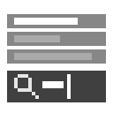
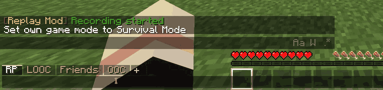
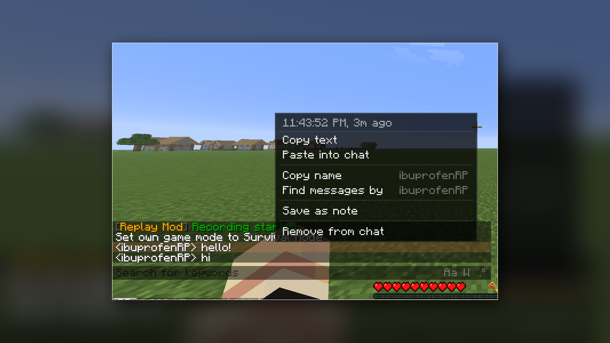
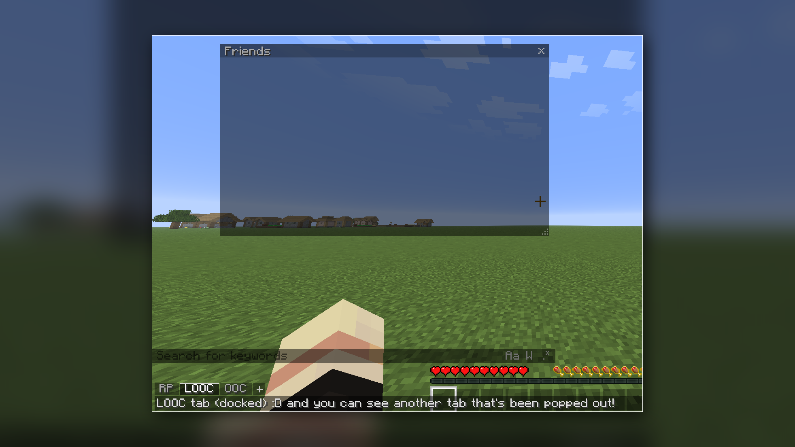
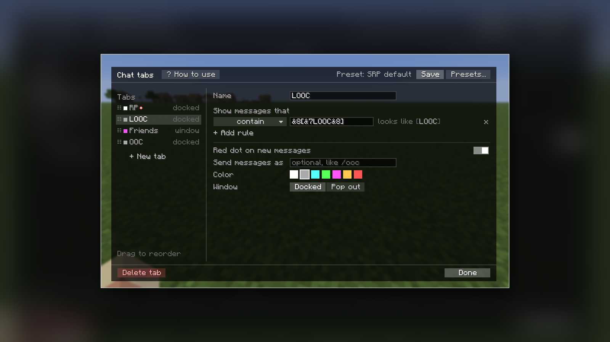
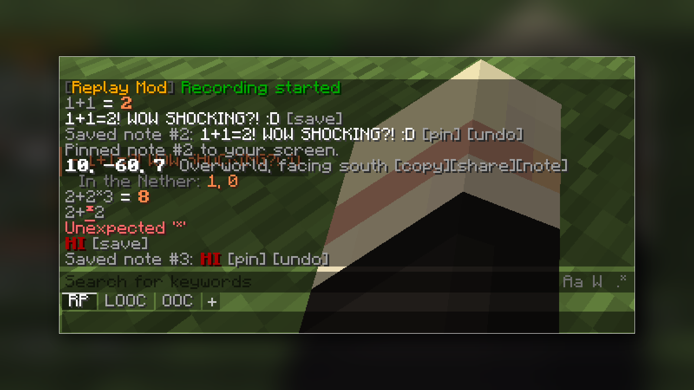

<p align="center">
  
</p>

<h1 align="center">Chat Toolkit</h1>

<p align="center">
  A client-side Fabric mod that makes the Minecraft chat easier to live in.<br>
  Search it, right-click to copy messages, split it into tabs you can pop out, plus a calculator, notes and timers.
</p>

<p align="center">
  <a href="https://modrinth.com/mod/chattoolkit">Modrinth</a> ·
  <a href="https://github.com/HighBitRates/chat-toolkit/releases">Releases</a> ·
  <a href="https://github.com/HighBitRates/chat-toolkit/issues">Report a bug</a>
</p>

<p align="center">
  <a href="https://github.com/HighBitRates/chat-toolkit/actions/workflows/build.yml"></a>
</p>



## Install

1. Install [Fabric Loader](https://fabricmc.net/use/) for Minecraft 26.3.
2. Put the Chat Toolkit jar and [Fabric API](https://modrinth.com/mod/fabric-api) in your `mods` folder. Get the jar from [Modrinth](https://modrinth.com/mod/chattoolkit) or the [releases page](https://github.com/HighBitRates/chat-toolkit/releases).
3. [Mod Menu](https://modrinth.com/mod/modmenu) is optional, but it gives you an easy way into the settings.

It's client-side only, so it works on any server.

## Search

A search bar sits under the chat. Click it or press **Ctrl+F** with the chat open, then type. Matching messages are filtered and highlighted, with a counter. Toggles let you match case (Aa), whole words (W) or use regex (.*). Right-click the bar to clear it.

## Right-click menu



Right-click any message to copy it, copy it with color codes, paste it into your message box, copy the sender's name, message them, find their other messages, copy a link or coordinates, save it as a note, or remove it from your chat. Middle-click copies a message instantly.

## Chat tabs



Open chat with T and the tabs sit on top of the message box. Click one to only see those messages. A red dot means something new came in there.

- **Pop tabs out.** Hover a tab and click the little arrow to turn it into a window. Drag it by its title, resize it from the corner and scroll it with the mouse wheel. With the chat closed it shows recent lines like the normal chat. Drag it back onto the tabs (or click its x) to dock it again.
- **Send through a tab.** If a tab has "Send messages as" set (like `/ooc {message}`), anything you type while it's selected goes through that command. Click a window before typing to send through it.
- **Rules.** A rule can be "contain", "start with" or "everything else", and it uses `&` color codes, so `&8[&7OOC&8]` only catches a gray [OOC] tag.
- **Presets.** Save your whole tab setup. SRP default comes built in (RP, OOC, LOOC, Friends). Give a preset a server address and it loads by itself when you join. Share presets through your clipboard or as files in `config/chattoolkit/presets`, or drag .json files onto the game window while the tab editor is open.



Open the editor from the settings, by right-clicking a tab, or with the + button. There's a How to Use page in the settings too.

## Commands



| Command | What it does |
| --- | --- |
| `/ccalc <expression>` | Calculator with implicit multiplication, `%`, units (st, sb, chest, dc, k), functions like `nether()`, `stacks()` and `dist()`, variables and `ans` |
| `/cnote ...` / `/cnotes ...` | Notes: list, add, here (saves your coords), remove, pin, unpin, copy, show, edit, search, clear |
| `/ctimer <duration> [label]` | Countdown timer with a sound when it ends |
| `/ccoords` | Copy or share your coordinates, with the Nether conversion |
| `/chattoolkit` or `/ctk` | Open settings. `/ctk help` lists everything, `/ctk reload` reloads the config |

Pinned notes and timers show in a small panel you can drag anywhere while the chat is open. Right-click it to send it back to its corner.

## More

- In survival the chat and search bar move up above your hearts, armor and hunger. In creative they stay at the normal height.
- Chat history goes past vanilla's 100 line limit.
- Optional timestamps.
- Settings for opacity, colors, search bar width, animations and more, from Mod Menu, `/ctk` or a keybind.

## Works with

- **Chat Animation.** Messages still slide in, and messages that go to another tab don't make the main chat jump.
- **Client Commands.** Chat Toolkit takes over `/ccalc` and `/cnote` by default. You can turn that off in the settings.

## Building from source

Requires JDK 25.

```
./gradlew build
```

The jar ends up in `build/libs/`. Every push is also built by GitHub Actions, and the jar can be downloaded from the run.

Settings live in `config/chattoolkit.json`, and notes and tabs in `config/chattoolkit/`.

## License

[MIT](LICENSE)
